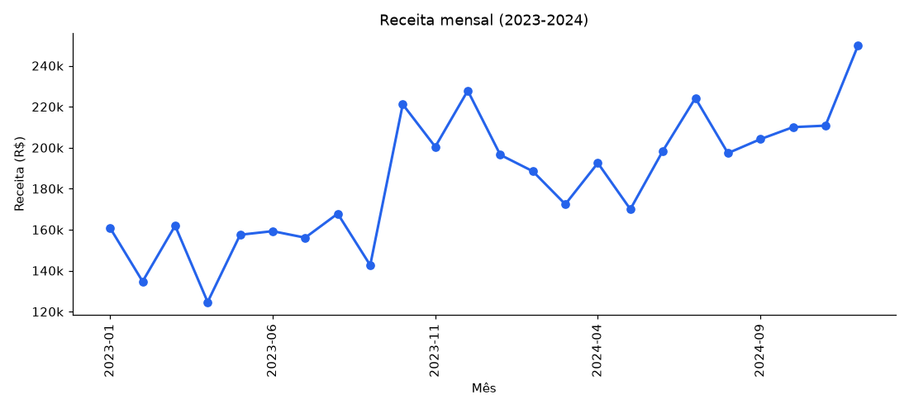
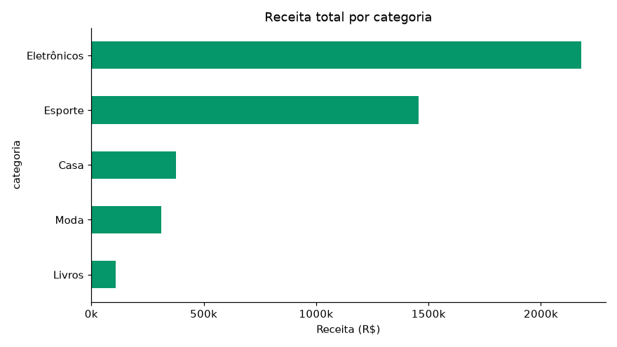
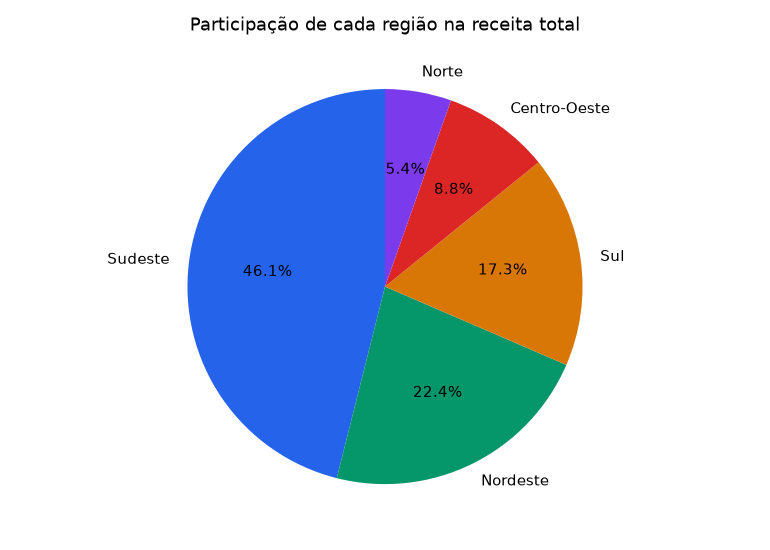
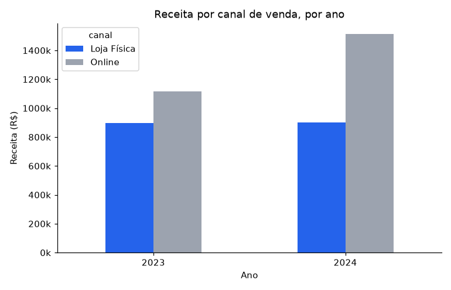
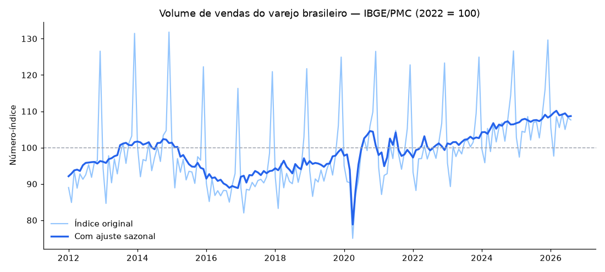
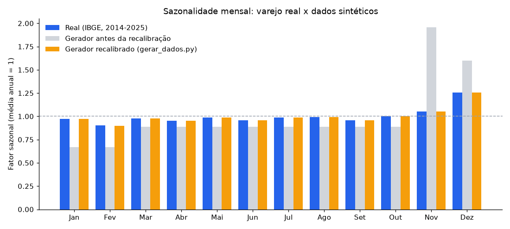

# Análise de Vendas de E-commerce (Python + SQL)

<p align="left">
  
  
  
  
</p>

Projeto de análise de dados de ponta a ponta: geração de um dataset sintético e reprodutível de vendas de e-commerce, carga em banco SQL, consultas de negócio e análise exploratória com pandas, com gráficos e conclusões.

> **Por que dados sintéticos?** Para um projeto público, gerar os próprios dados (com seed fixa, em `src/gerar_dados.py`) evita problemas de licença/privacidade de datasets de terceiros e permite controlar os padrões (crescimento do canal online e sazonalidade de fim de ano). A sazonalidade mensal é **calibrada com dados reais do IBGE** (veja "Versão com dados reais"); o restante (preços, regiões, categorias) é sintético.

## Estrutura

```
analise-vendas/
├── src/
│   ├── gerar_dados.py      # Gera data/vendas.csv (6.655 registros, 2023-2024)
│   ├── carregar_sqlite.py  # Carrega o CSV em data/vendas.db (SQLite)
│   ├── analise.py          # Análise com pandas + geração dos gráficos em imgs/
│   ├── analise_ibge.py     # Versão com dados REAIS: PMC/IBGE (API SIDRA) x dados sintéticos
│   └── exportar_powerbi.py # Modelo estrela em CSV para o Power BI (data/powerbi/)
├── sql/
│   └── consultas.sql       # 8 consultas de negócio comentadas
├── powerbi/                # Medidas DAX e roteiro para montar o dashboard no Power BI
├── imgs/                   # Gráficos gerados (PNG)
├── tests/                  # Testes pytest (dados, métricas, IBGE, exportação)
└── requirements.txt
```

## Como reproduzir

```bash
pip install -r requirements.txt

python src/gerar_dados.py       # gera data/vendas.csv
python src/carregar_sqlite.py   # gera data/vendas.db a partir do CSV
python src/analise.py           # roda a análise e regrava os gráficos em imgs/
python src/analise_ibge.py      # baixa dados reais do IBGE e compara a sazonalidade
python src/exportar_powerbi.py  # gera os CSVs do modelo estrela para o Power BI

pytest tests/ -v                # 38 testes (sem internet)
```

As consultas de `sql/consultas.sql` podem ser rodadas com qualquer cliente SQLite sobre `data/vendas.db`.

## Principais achados

*(números reais, gerados pela execução de `src/analise.py` sobre os dados sintéticos de `src/gerar_dados.py`)*

- **Receita total (2023-2024): R$ 4.429.491,93**, em 6.655 vendas.
- **Crescimento ano a ano de 19,8%**: de R$ 2.014.881,46 em 2023 para R$ 2.414.610,47 em 2024.
- **Eletrônicos é a categoria líder**, respondendo por **49,2%** de toda a receita — bem à frente de Esporte (32,9%).
- **Sudeste concentra 46,1%** da receita, seguido por Nordeste (22,4%) e Sul (17,3%) — reflexo dos pesos populacionais usados na geração dos dados.
- **O fim de ano vende mais, mas de forma moderada**: a receita média mensal em novembro/dezembro (R$ 222.207,11) é **1,26x maior** que nos demais meses (R$ 177.033,17), e **dezembro é o mês mais forte nos dois anos**. A calibração com o IBGE aponta 1,19x; o valor medido é um pouco maior porque a receita também cresce de 2023 para 2024, e novembro/dezembro ficam no fim de cada ano.
- **O canal Online cresceu de participação**: de **55,4%** da receita em 2023 para **62,6%** em 2024. A loja física ficou praticamente estável (R$ 898.551,84 em 2023 e R$ 902.180,53 em 2024), então quase todo o crescimento do período (R$ 396.100,32 dos R$ 399.729,01) veio do Online.

### Receita mensal (2023-2024)



Os dois meses de maior receita do período são dezembro de 2024 (R$ 249.814) e dezembro de 2023 (R$ 227.814), seguidos pela tendência de crescimento ao longo dos dois anos. O pico de fim de ano existe, mas é bem mais suave que o de um dataset com sazonalidade escolhida à mão.

### Receita por categoria



### Participação por região



### Online vs. Loja Física, por ano



## Versão com dados reais (IBGE)

A primeira versão deste dataset sintético usava uma sazonalidade escolhida à mão (novembro 2,2x, dezembro 1,8x, janeiro/fevereiro 0,75x). Para testar essa suposição contra a realidade, `src/analise_ibge.py` baixa da **API pública do IBGE (SIDRA, tabela 8880)** a Pesquisa Mensal de Comércio: o índice de volume de vendas do varejo brasileiro (2022 = 100), mensal, de janeiro de 2000 a agosto de 2026 (320 meses).

*(números reais, da execução de `src/analise_ibge.py` com a API do IBGE em 12/11/2026)*

- **Queda na pandemia:** o índice com ajuste sazonal caiu **19,7%** entre fevereiro e abril de 2020.
- **Crescimento recente:** a média anual do índice variou **+1,7% em 2023**, **+4,1% em 2024** e **+1,6% em 2025**. O pico histórico (com ajuste sazonal) foi **110,1 em março de 2026**.
- **O fim de ano real é mais fraco do que a calibração antiga supunha:** no varejo real (média de 2014 a 2025), novembro e dezembro vendem **1,19x** mais que os outros meses. A calibração antiga do gerador equivalia a **2,11x**.
- **Dezembro vence novembro no mundo real:** fator sazonal de **1,26 em dezembro** contra **1,05 em novembro**. A calibração antiga supunha o contrário (novembro 1,96 contra dezembro 1,60).



### Recalibração do gerador

Com base nisso, o gerador (`FATOR_SAZONAL_MES` em `src/gerar_dados.py`) passou a usar os **fatores sazonais reais do IBGE** (média de 2014 a 2025). Os valores ficam fixos no código para a geração continuar offline e reprodutível. No gráfico, as barras laranja (gerador recalibrado) agora acompanham as azuis (real), enquanto as cinza mostram a calibração antiga:



**O que mudou nos números do projeto:** como o fator sazonal médio caiu, o dataset passou de 7.618 para **6.655 vendas** (de R$ 4.834.928,89 para **R$ 4.429.491,93**), o efeito de fim de ano medido nas vendas foi de 2,15x para **1,26x**, e vários achados mudaram de forma (por exemplo, a loja física deixou de recuar e ficou estável). Todos os números da seção "Principais achados" foram regerados com a nova calibração.

Como o fator sazonal real é calculado: razão entre o índice original e o índice com ajuste sazonal do próprio IBGE, média por mês do ano, normalizada para média 1. Os testes usam uma amostra real da resposta da API salva em `tests/fixtures/pmc_amostra.json` (sem internet).

## Dashboard no Power BI

O dashboard interativo se monta no Power BI Desktop, que não roda em linha de comando. O que está pronto neste repositório:

- `src/exportar_powerbi.py`: transforma o `vendas.csv` em um **modelo estrela** (fato de vendas + calendário, produto, região e canal) em `data/powerbi/`, em formato brasileiro (`;` e vírgula decimal) ou americano (`--formato us`).
- [`powerbi/medidas.dax`](powerbi/medidas.dax): medidas prontas (receita, ticket médio, crescimento sobre o ano anterior, participação, efeito de alta temporada).
- [`powerbi/ROTEIRO.md`](powerbi/ROTEIRO.md): passo a passo de importação, relacionamentos, medidas e três páginas sugeridas, mais uma checagem para conferir se o dashboard bate com os números do README (receita total de R$ 4.429.491,93, 6.655 vendas, crescimento de 19,8%).

Conferi no Python que o modelo exportado preserva os totais (as 6.655 linhas e a receita de R$ 4.429.491,93 batem com o CSV original, e o calendário cobre os 731 dias de 2023 e 2024). As medidas DAX seguem padrões clássicos, mas ainda não foram executadas dentro do Power BI Desktop.

## Consultas SQL (`sql/consultas.sql`)

8 consultas de negócio, entre elas:

1. Receita e ticket médio por mês
2. Top 5 produtos por receita
3. Receita por categoria, com % de participação
4. Receita por região
5. Online vs. Loja Física, por ano
6. Efeito da alta temporada (Nov/Dez) no ticket médio
7. Categoria líder em cada região (usando `RANK() OVER (PARTITION BY ...)`)
8. Crescimento ano a ano da receita total

## Testes

38 testes com `pytest` (nenhum depende de internet), cobrindo:
- reprodutibilidade da geração de dados (mesma seed → mesmo resultado)
- validade dos dados gerados (datas no período, categorias/produtos válidos, receita consistente)
- corretude dos cálculos de métricas de negócio usados no relatório
- análise do IBGE: leitura da resposta da API (amostra real salva), fator sazonal, variações anuais e a requisição mockada
- modelo estrela do Power BI: totais preservados, chaves sem órfãos, calendário contínuo e formatos de CSV

## Próximos passos

- [ ] Montar o dashboard no Power BI Desktop e publicar as capturas (o modelo, as medidas DAX e o roteiro já estão prontos em `powerbi/`)
- [x] Versão com dados reais de uma API pública (IBGE/PMC, veja "Versão com dados reais")
- [x] Recalibrar o gerador sintético com a sazonalidade real do IBGE (veja "Recalibração do gerador")
