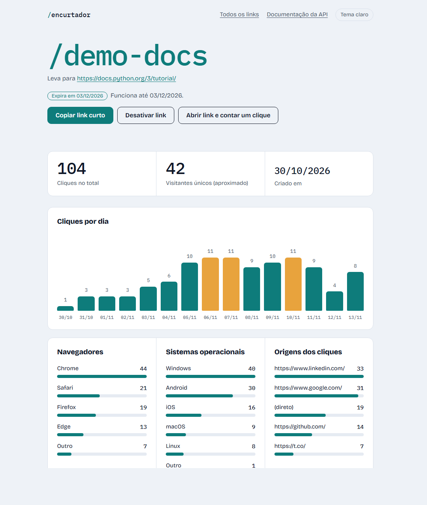
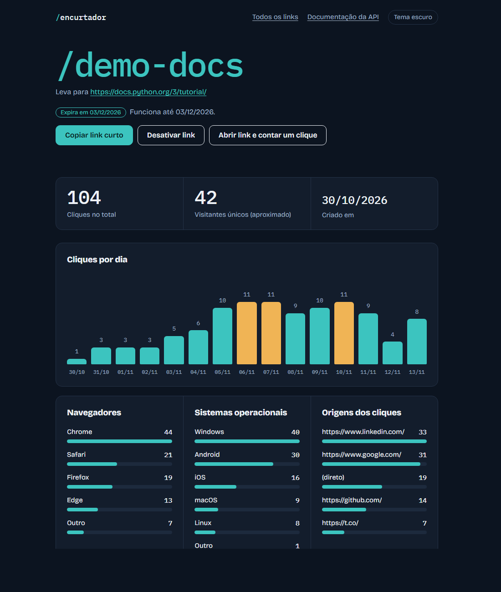
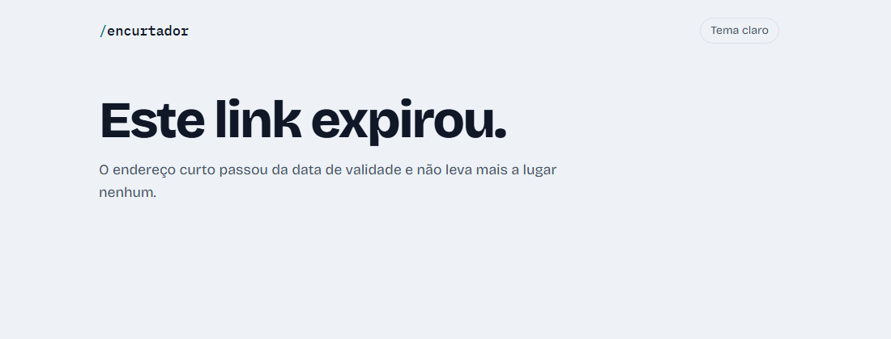
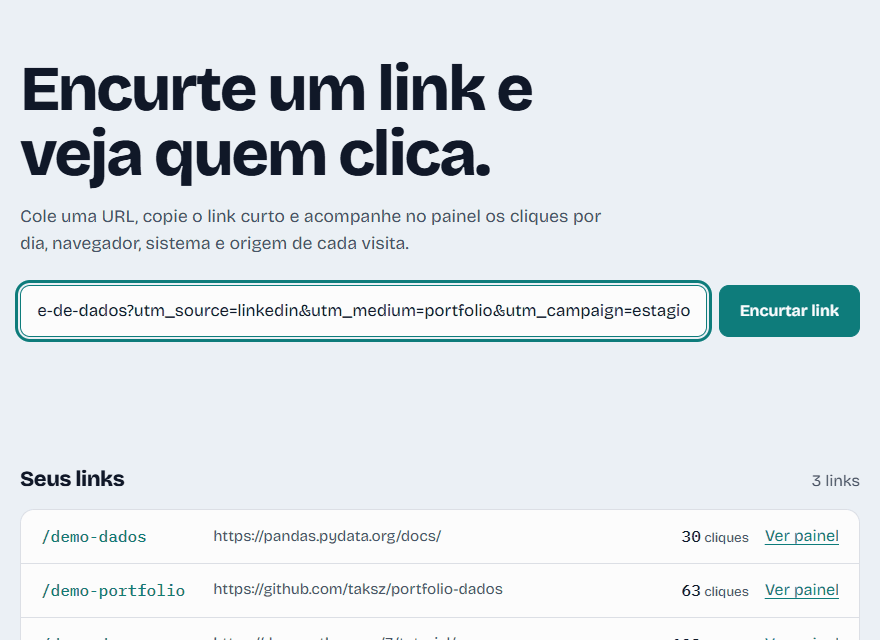

# Encurtador de URL com Analytics

<p align="left">
  
  
  
  
</p>

API em Python (FastAPI) que encurta URLs e registra **analytics de cada clique**: quantidade de acessos, visitantes únicos (aproximado), navegador, sistema operacional e origem (referrer) — com uma interface web para encurtar links e um painel de cliques.

## Funcionalidades

- **Encurtar URL** — gera um código curto em base62 (6 caracteres, ex.: `TTTYrF`).
- **Redirecionamento** — `GET /{codigo}` redireciona (302) para a URL original e registra o clique. Se o link expirou ou foi desativado, responde **410** com um aviso em português e **não conta o clique**.
- **Analytics por link**: total de cliques, visitantes únicos aproximados, cliques por dia, navegador, sistema operacional e top referrers.
- **Página inicial** (`/`) — cola a URL, copia o link curto e vê a lista de todos os links com o total de cliques.
- **Painel de cliques** (`/dashboard/{codigo}`) — gráfico de cliques por dia e rankings de navegadores, sistemas e origens, com atualização a cada 5 segundos. JavaScript puro, sem biblioteca de gráficos.
- **Tema claro, escuro ou automático**: o botão no topo alterna e o navegador lembra a escolha (também aceita `?tema=claro` ou `?tema=escuro` na URL).
- **Validade e desativação de links**: ao encurtar, escolha "expira em 1, 7 ou 30 dias" (ou sem expiração). Depois dá para desativar, reativar ou renovar cada link na página inicial, no painel ou pela API (`PATCH /api/urls/{codigo}`).
- **Senha opcional**: com a variável `ENCURTADOR_SENHA` definida, a página inicial, o painel e a API passam a pedir login (HTTP Basic). Os links curtos continuam públicos.
- **Privacidade por padrão**: o IP do visitante nunca é armazenado em texto puro — só o hash SHA-256 dele, usado apenas para estimar visitantes únicos.

## Estrutura

```
encurtador-url/
├── app/
│   ├── main.py           # Endpoints da API (FastAPI)
│   ├── models.py         # Acesso a dados (SQLite): criar URL, registrar clique, estatísticas
│   ├── shortener.py      # Geração de código base62 + validação de URL
│   ├── user_agent.py     # Parser simples (regex) de navegador/SO a partir do User-Agent
│   ├── demo.py           # Popula o banco com links e cliques SIMULADOS (só para demonstração)
│   └── static/
│       ├── index.html    # Página inicial (encurtar + lista de links)
│       ├── dashboard.html  # Painel de cliques de um link
│       ├── style.css     # Estilos compartilhados (claro/escuro)
│       └── app.js        # Tema, copiar link e funções compartilhadas
├── imgs/                 # Capturas de tela da interface
├── tests/                # 92 testes pytest
└── requirements.txt
```

## Como executar

```bash
pip install -r requirements.txt
uvicorn app.main:app --reload
```

A API sobe em `http://127.0.0.1:8000`.

### Exemplo de uso (via curl)

```bash
# 1. Encurtar uma URL
curl -X POST http://127.0.0.1:8000/api/shorten \
  -H "Content-Type: application/json" \
  -d '{"url": "https://www.google.com/search?q=python", "expira_em_dias": 7}'
# -> {"codigo":"TTTYrF","url_original":"https://www.google.com/search?q=python","url_curta":"http://127.0.0.1:8000/TTTYrF","expira_em":"2026-11-20T19:48:05.016754+00:00"}

# 2. Acessar a URL curta (redireciona e registra o clique)
curl -L http://127.0.0.1:8000/TTTYrF

# 3. Ver as estatísticas desse link
curl http://127.0.0.1:8000/api/analytics/TTTYrF
```

Saída real do passo 3, após 2 cliques (um vindo de `google.com`, outro direto, um Chrome e um Firefox):

```json
{
  "codigo": "TTTYrF",
  "url_original": "https://www.google.com/search?q=python",
  "criado_em": "2026-11-13T19:48:05.019273+00:00",
  "expira_em": "2026-11-20T19:48:05.016754+00:00",
  "ativo": true,
  "status": "ativo",
  "total_cliques": 2,
  "visitantes_unicos_aprox": 1,
  "cliques_por_dia": [{"dia": "2026-11-13", "cliques": 2}],
  "navegadores": [{"navegador": "Firefox", "cliques": 1}, {"navegador": "Chrome", "cliques": 1}],
  "sistemas_operacionais": [{"sistema_operacional": "Windows", "cliques": 1}, {"sistema_operacional": "Linux", "cliques": 1}],
  "top_referrers": [{"referrer": "https://google.com", "cliques": 1}, {"referrer": "(direto)", "cliques": 1}]
}
```

Desativar, reativar e renovar a validade (saídas reais):

```bash
# 4. Desativar: quem abrir o link curto recebe 410 e o clique não conta
curl -X PATCH http://127.0.0.1:8000/api/urls/TTTYrF \
  -H "Content-Type: application/json" -d '{"ativo": false}'
# -> {"codigo":"TTTYrF","ativo":false,"expira_em":"2026-11-20T19:48:05.016754+00:00","status":"desativado"}

curl -s -o /dev/null -w "%{http_code}\n" http://127.0.0.1:8000/TTTYrF
# -> 410

# 5. Reativar e renovar a validade por mais 30 dias
curl -X PATCH http://127.0.0.1:8000/api/urls/TTTYrF \
  -H "Content-Type: application/json" -d '{"ativo": true, "expira_em_dias": 30}'
# -> {"codigo":"TTTYrF","ativo":true,"expira_em":"2026-12-13T19:48:18.834002+00:00","status":"ativo"}
```

Ou abra `http://127.0.0.1:8000/dashboard/TTTYrF` no navegador para ver o mesmo resultado em gráficos.

Também dá para explorar e testar todos os endpoints pela documentação interativa automática do FastAPI, em `http://127.0.0.1:8000/docs`.

## Interface

Depois de subir o servidor, abra `http://127.0.0.1:8000/` no navegador. Dá para encurtar links, copiar o link curto e abrir o painel de cada um sem digitar nenhum comando.

> O GitHub só mostra o código e as imagens: a API é um servidor Python e precisa ser executada na sua máquina (veja "Como executar"). As capturas abaixo vêm da própria interface rodando.






A lista mostra o estado de cada link (ativo, com a data de expiração, expirado ou desativado) e o botão com a ação certa para ele: desativar, reativar ou renovar por 30 dias. Quem abre um link expirado ou desativado vê este aviso (HTTP 410), e o clique não é contado:



Ao encurtar um link, a interface mostra o endereço longo encolhendo até virar o código curto:



**Os cliques das capturas são simulados.** Um projeto recém-clonado não tem cliques, então o comando abaixo cria 5 links (`demo-docs`, `demo-portfolio`, `demo-dados`, `demo-expirado` e `demo-desativado`) com 14 dias de cliques pseudoaleatórios (semente fixa). Os dois últimos existem para mostrar os estados "expirado" e "desativado". Os dados não são reais:

```bash
python -m app.demo           # cria os links de demonstração
python -m app.demo --limpar  # remove só os links de demonstração
```

## Senha e links com validade

**Senha.** Por padrão o app fica aberto, como convém no desenvolvimento local. Para proteger, defina a variável `ENCURTADOR_SENHA` antes de subir o servidor:

```bash
# Linux/macOS
ENCURTADOR_SENHA="uma-senha-forte" uvicorn app.main:app
```

```powershell
# Windows (PowerShell)
$env:ENCURTADOR_SENHA = "uma-senha-forte"
uvicorn app.main:app
```

O navegador passa a pedir usuário e senha (usuário `admin`, ou o valor de `ENCURTADOR_USUARIO`). O que fica protegido e o que continua público:

| Rota | Com senha ligada |
|---|---|
| `/` (página inicial), `/dashboard/{codigo}`, `POST /api/shorten`, `GET /api/urls`, `PATCH /api/urls/{codigo}`, `GET /api/analytics/{codigo}` | pede login |
| `GET /{codigo}` (o link curto em si), `/healthz` (verificação de saúde da hospedagem), `/static/*`, `/docs` | público |

A autenticação é HTTP Basic: usuário e senha vão em cada requisição, por isso **use sempre HTTPS** em hospedagem (o Render já serve HTTPS). A senha vem só da variável de ambiente, nunca do código, e é comparada em tempo constante. É uma proteção simples para um projeto pequeno, com um único usuário; não substitui um sistema de contas.

**Validade.** Ao criar o link, `expira_em_dias` (1 a 3650) define até quando ele funciona; sem esse campo, nunca expira. Depois da data, ou se o link for desativado, o endereço curto responde 410 e o clique não é registrado. O `PATCH /api/urls/{codigo}` aceita `ativo` (true/false), `expira_em_dias` (nova validade, contada a partir de agora) ou `sem_expiracao` (true remove a data). Bancos criados antes dessa funcionalidade são atualizados sozinhos na primeira subida.

## Publicar online (Render)

Para qualquer pessoa usar o encurtador pelo navegador, sem instalar nada, o projeto precisa estar hospedado. O repositório já traz o arquivo `render.yaml` na raiz, que descreve o serviço para o [Render](https://render.com) (plano grátis, roda Python):

1. Crie uma conta no Render e escolha **New > Blueprint**.
2. Conecte o repositório `portfolio-dados`. O Render lê o `render.yaml` e propõe o serviço `encurtador-url`.
3. Confirme. Em alguns minutos o site fica no ar em um endereço `https://encurtador-url-xxxx.onrender.com`.

Variáveis de ambiente que o projeto reconhece:

| Variável | Efeito |
|---|---|
| `ENCURTADOR_DB` | Caminho do arquivo SQLite (padrão: `encurtador.db` na pasta do projeto). |
| `ENCURTADOR_SENHA` | Protege a página inicial, o painel e a API com senha (HTTP Basic). Veja "Senha e links com validade". |
| `ENCURTADOR_USUARIO` | Nome de usuário do login (padrão: `admin`). |
| `ENCURTADOR_DEMO` | Com `1`, se o banco estiver vazio ao iniciar, cria os links de demonstração com cliques **simulados**. |

O `render.yaml` publica uma **demonstração aberta, sem senha**, com dados simulados, para qualquer pessoa poder ver o painel. Se for usar de verdade, abra o serviço no Render, vá em **Environment** e adicione `ENCURTADOR_SENHA` com uma senha forte.

No plano grátis o disco é apagado a cada reinício e o serviço "dorme" depois de um tempo sem acessos (a primeira visita seguinte demora uns segundos). Por isso o `render.yaml` liga `ENCURTADOR_DEMO=1`: o site sempre abre com dados de exemplo. Links criados por visitantes não são permanentes nessa hospedagem. Para guardá-los, é preciso um disco persistente (plano pago do Render) apontado por `ENCURTADOR_DB`.

## Modelo de dados (SQLite)

```
urls(id, codigo, url_original, criado_em, expira_em, ativo)
cliques(id, url_id, clicado_em, referrer, navegador, sistema_operacional, ip_hash)
```

## Testes

92 testes com `pytest`, cobrindo geração/validação de código, parser de User-Agent, camada de dados (SQLite em memória), expiração e desativação de links (incluindo a migração de bancos antigos), autenticação por senha e a API de ponta a ponta (com `TestClient` do FastAPI):

```bash
pytest tests/ -v
```

## Próximos passos

- [x] Autenticação simples para o dashboard (senha por `ENCURTADOR_SENHA`; veja "Senha e links com validade")
- [x] Expiração/desativação de links
- [ ] Deploy público (Render/Railway) com link ao vivo no README (o projeto e o `render.yaml` estão prontos; falta criar a conta e o serviço no Render e colar o link aqui)
