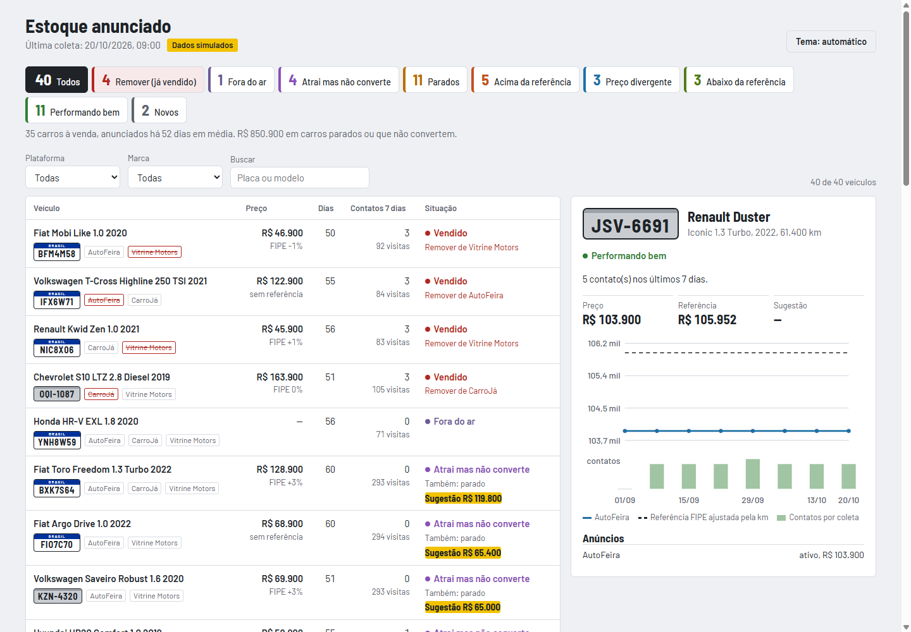
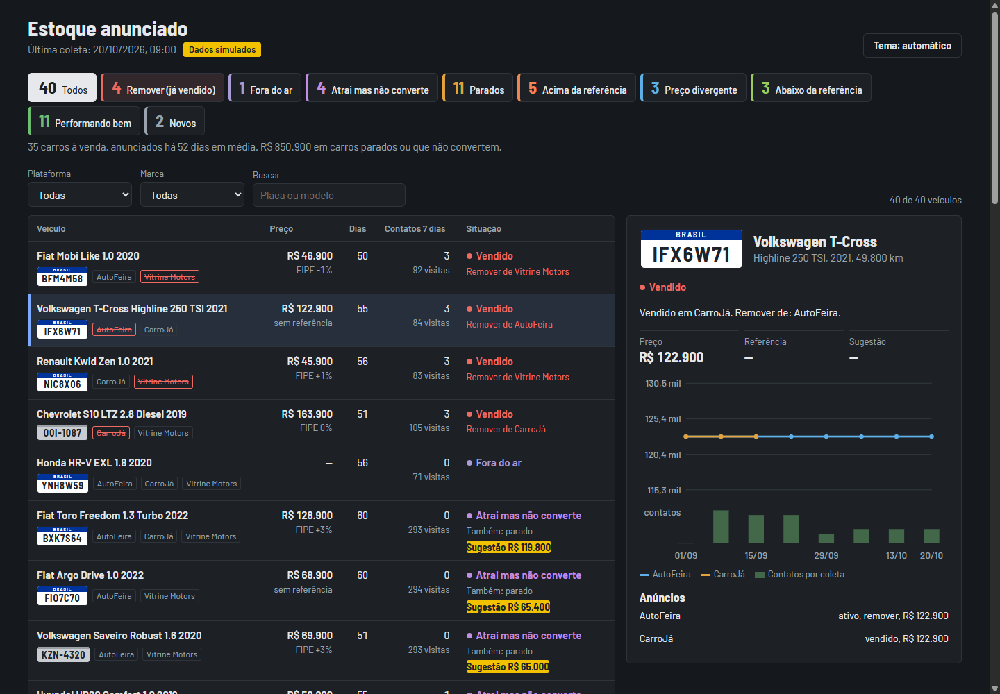

# Gestor de Anúncios

<p align="left">
  
  
  
  
  
</p>

MVP de um sistema de **gestão de anúncios de veículos** para lojas e revendas que mantêm dezenas de carros anunciados em várias plataformas ao mesmo tempo e não têm tempo de revisar um por um. A cada coleta, o sistema guarda um *snapshot* de cada anúncio, junta os anúncios do mesmo carro pela **placa** e classifica cada veículo:

- **vendido**: vendeu em uma plataforma, e os anúncios que sobraram nas outras precisam ser removidos;
- **parado**: muito tempo anunciado e quase nenhum contato;
- **atrai mas não converte**: muitas visitas e quase nenhum contato;
- **preço fora do esperado**: muito acima ou abaixo da referência (FIPE ou mediana de carros parecidos, ajustada pela quilometragem), ou com preço diferente entre plataformas;
- **performando bem**.

Para os parados e caros, o sistema sugere um preço novo.

**Demonstração ao vivo do painel:** [gestor-anuncios-6xy4.onrender.com](https://gestor-anuncios-6xy4.onrender.com). É uma demonstração pública, somente leitura, com 8 semanas de coletas **simuladas** de 40 carros fictícios: o botão de coleta e a coleta automática ficam desligados na nuvem. No plano grátis do Render a primeira visita pode levar cerca de um minuto (o serviço "dorme" quando ninguém acessa).

> **Ainda não há integração com plataformas reais.** A coleta passa por uma interface de adaptadores (veja [Plugando uma plataforma real](#plugando-uma-plataforma-real)), e o projeto vem com um adaptador de **demonstração** que gera anúncios **simulados**: 40 carros fictícios em 3 plataformas fictícias (AutoFeira, CarroJá e Vitrine Motors), com placas e valores de referência inventados.

## Funcionalidades

- **Arquitetura de adaptadores**: classe abstrata `AdaptadorPlataforma` com um único método, `coletar(agora)`, que devolve título/modelo, preço, visualizações, contatos, status e data de publicação de cada anúncio.
- **Adaptador DEMO** determinístico (semente fixa): cada carro tem um "perfil" (vende bem, parado, caro, não converte, vendido no meio do período, preço divergente…) que define o ritmo de visitas e contatos ao longo do tempo.
- **Histórico em SQLite**: um snapshot por anúncio a cada coleta. Anúncio que some da plataforma fica marcado como `ausente`, e não como vendido.
- **Motor de regras** por veículo, com limites configuráveis (`regras.Config`) e sugestão de preço com piso.
- **Alertas sem repetição**: uma linha em `alertas.log` só quando a situação de um carro **muda** (ex.: de "performando bem" para "parado").
- **Agendador** com a biblioteca `schedule`. A falha de uma plataforma é logada e não derruba as outras nem o agendador. Uma resposta vazia de uma plataforma que tinha anúncios ativos conta como falha, para não marcar o estoque inteiro como fora do ar. Se nenhuma plataforma responder, as situações ficam como estavam.
- **Painel web (FastAPI)**: placar por situação (que também filtra), filtros por plataforma, marca e busca por placa/modelo, tabela com sinalização e painel de detalhe com gráfico de preço por plataforma, linha de referência e contatos por coleta. Tema claro/escuro, funciona no celular.
- **CLI** para gerar a demonstração, coletar, agendar, listar e abrir o painel.

## Estrutura

```
gestor-anuncios/
├── src/
│   ├── modelos.py        # AnuncioColetado + normalização de placa (antiga e Mercosul)
│   ├── adaptadores/
│   │   ├── base.py       # Interface AdaptadorPlataforma (ponto de extensão)
│   │   └── demo.py       # Plataformas e anúncios SIMULADOS
│   ├── banco.py          # SQLite: veículos, anúncios, snapshots, situações
│   ├── regras.py         # Classificação de cada veículo + sugestão de preço
│   ├── alertas.py        # Log de alertas (só mudanças de situação)
│   ├── coleta.py         # Orquestra: coletar -> salvar -> avaliar -> alertar
│   ├── agendador.py      # Coleta periódica (schedule)
│   ├── demo.py           # Gera 8 semanas de coletas simuladas (demo.db)
│   ├── web.py            # API FastAPI + painel
│   ├── static/           # index.html, style.css, app.js (sem dependências externas de JS)
│   └── cli.py            # Interface de linha de comando
├── tests/                # 102 testes pytest, sem acesso à internet
├── imgs/
└── requirements.txt
```

## Como executar

```bash
cd gestor-anuncios
pip install -r requirements.txt

python src/cli.py demo                                        # cria demo.db com 8 coletas semanais SIMULADAS
python src/cli.py listar --db demo.db                         # situação de cada veículo
python src/cli.py listar --db demo.db --situacao parado       # só os parados
python src/cli.py servir --db demo.db --alertas alertas-demo.log --somente-leitura   # painel em http://127.0.0.1:8000

python src/cli.py coletar                      # uma coleta agora (adaptador demo, banco anuncios.db)
python src/cli.py agendar --intervalo-min 60   # coleta a cada 60 min (Ctrl+C para parar)
```

Opções úteis: `--db`, `--alertas`, `--log` (grava o log da execução em arquivo), `--adaptador` (hoje só `demo`). No `servir`: `--host`, `--porta`, `--somente-leitura` (desliga o botão **Coletar agora**) e `--demo` (cria o histórico simulado se o banco estiver vazio). Use `python src/cli.py <comando> --help` para ver todas.

### Exemplo real de uso

Saída real de `python src/cli.py listar --db demo.db` (dados **simulados**, primeiras linhas). A lista vem da situação mais urgente para a menos urgente:

```text
Situação                    Placa    Veículo                                          Preço    Sugestão
Vendido                     BFM4M58  Fiat Mobi Like 1.0 2020                      R$ 46.900           —
Vendido                     IFX6W71  Volkswagen T-Cross Highline 250 TSI 2021    R$ 122.900           —
Vendido                     NIC8X06  Renault Kwid Zen 1.0 2021                    R$ 45.900           —
Vendido                     OQI1087  Chevrolet S10 LTZ 2.8 Diesel 2019           R$ 163.900           —
Fora do ar                  YNH8W59  Honda HR-V EXL 1.8 2020                              —           —
Atrai mas não converte      BXK7S64  Fiat Toro Freedom 1.3 Turbo 2022            R$ 128.900  R$ 119.800
Atrai mas não converte      FIO7C70  Fiat Argo Drive 1.0 2022                     R$ 68.900   R$ 65.400
```

Nos vendidos, o preço mostrado é o do anúncio que **continua ativo** em outra plataforma, aquele que precisa ser removido.

`listar --situacao preco_alto`:

```text
Situação                    Placa    Veículo                                          Preço    Sugestão
Preço acima da referência   ABH1958  Honda City EXL 1.5 2022                     R$ 134.900  R$ 111.600
Preço acima da referência   AVG1I98  Toyota Corolla XEi 2.0 2020                 R$ 141.900  R$ 113.400
Preço acima da referência   NPR7757  Ford EcoSport Freestyle 1.5 2019             R$ 91.900   R$ 75.200
Preço acima da referência   SHS1T53  Fiat Strada Volcano 1.3 2023                R$ 132.900  R$ 103.300
Preço acima da referência   UKO3V65  Honda Civic EXL 2.0 2019                    R$ 137.900  R$ 112.500
```

Conteúdo real do `alertas-demo.log` (uma linha por mudança de situação, com data da coleta, placa e mensagem; as 8 coletas geraram 25 linhas):

```text
2026-09-01T09:00:00 | ALERTA | BXK7S64 | Fiat Toro Freedom 1.3 Turbo 2022: Atrai mas não converte — 287 visitas e só 0 contato(s) em 7 dias. Sugestão: R$ 119.800.
2026-09-01T09:00:00 | ALERTA | ABH1958 | Honda City EXL 1.5 2022: Preço acima da referência — Preço +24% em relação à referência (FIPE, ajustada pela km). Sugestão: R$ 111.600.
```

Modo automático (`agendar --intervalo-min 0.1 --execucoes 2`: uma coleta imediata e outra 6 segundos depois, com as linhas de alerta omitidas). A segunda coleta não gera alertas porque nenhuma situação mudou:

```text
2026-11-18 15:52:20,956 | INFO | Agendador iniciado: coleta a cada 6 segundo(s). Ctrl+C para parar.
2026-11-18 15:52:21,536 | INFO | Iniciando coleta em 3 plataforma(s)
2026-11-18 15:52:25,993 | INFO | Coleta concluída: 81 anúncio(s), 40 veículo(s), 28 alerta(s), 0 erro(s)
2026-11-18 15:52:26,958 | INFO | Iniciando coleta em 3 plataforma(s)
2026-11-18 15:52:27,169 | INFO | Coleta concluída: 81 anúncio(s), 40 veículo(s), 0 alerta(s), 0 erro(s)
```

## Painel web

`python src/cli.py servir --db demo.db --alertas alertas-demo.log --somente-leitura` abre o painel em `http://127.0.0.1:8000`. Sem `--somente-leitura`, aparece o botão **Coletar agora**. No banco de demonstração, ele grava uma coleta com a data de hoje, semanas depois do histórico simulado, e os números mudam de vez. Para voltar ao original, apague `demo.db` e `alertas-demo.log` e rode `demo` de novo. No topo fica o placar com quantos carros há em cada situação. Clicar em uma situação filtra a tabela, e o resumo logo abaixo mostra quantos carros estão à venda, há quantos dias em média e quanto dinheiro está parado. Clicar em um veículo abre o detalhe:

- o motivo da classificação;
- preço, referência e sugestão;
- o gráfico com o preço em cada plataforma, a referência tracejada e os contatos por coleta;
- a lista de anúncios, com o que precisa ser removido.

`?placa=<placa>` abre direto em um veículo. A rota `/docs` mostra a documentação interativa da API.

Painel com os dados **simulados** do `demo.db`, tema claro:



Tema escuro, com um carro vendido na CarroJá que continua anunciado na AutoFeira:



> O painel escuta só em `127.0.0.1` por padrão e não tem autenticação. Para expor em rede, use `--host` junto com `--somente-leitura`.

## Publicar o painel online (Render)

O painel está publicado em https://gestor-anuncios-6xy4.onrender.com, em modo **demonstração somente leitura**. O repositório já traz o serviço `gestor-anuncios` no `render.yaml` da raiz, e o Render sobe o servidor assim:

```bash
python src/cli.py servir --host 0.0.0.0 --porta $PORT --somente-leitura --demo
```

| Opção | O que faz |
|---|---|
| `--host 0.0.0.0` | Aceita visitas de fora da máquina (necessário em hospedagem). |
| `--somente-leitura` | Desliga o botão e a rota **Coletar agora** (responde 403). Assim, nenhum visitante grava coletas novas e os números da demonstração ficam estáveis. |
| `--demo` | Se o banco estiver vazio, cria as 8 semanas de coletas **simuladas** dos 40 carros fictícios, sem acessar a internet, e mostra a etiqueta "Dados simulados" no topo do painel. |

O plano grátis do Render apaga o disco a cada reinício, por isso a demonstração recria os dados simulados quando sobe. A coleta automática não roda na nuvem, porque um serviço grátis "dorme" quando ninguém acessa, e a primeira visita depois disso pode levar cerca de um minuto. O servidor responde `GET /healthz` (público, sem dados), que o Render usa para saber se o app está de pé.

Para publicar, o procedimento é o mesmo dos outros projetos: no Render, **New > Blueprint** com o repositório `portfolio-dados`. Se o Blueprint já existir, basta dar push no `render.yaml`, que ele sincroniza sozinho (ou use **Manual Sync**). A coleta, o agendador e o botão **Coletar agora** continuam funcionando quando o projeto roda na sua máquina.

### API

| Rota | O que devolve |
|---|---|
| `GET /api/resumo` | Contagem por situação, estoque ativo, média de dias anunciado, valor parado, plataformas e marcas |
| `GET /api/veiculos?situacao=&plataforma=&marca=&q=` | Veículos com diagnóstico (filtros combináveis; `situacao` inclui os sinais secundários) |
| `GET /api/veiculos/{placa}` | Detalhe, anúncios e histórico por coleta (aceita placa com hífen ou minúscula) |
| `POST /api/coletar` | Faz uma coleta agora (403 em `--somente-leitura`) |
| `GET /api/alertas?limite=20` | Últimos alertas |
| `GET /healthz` | Verificação de saúde |

## Regras de classificação

Cada **veículo** (placa) é avaliado somando seus anúncios em todas as plataformas. Visualizações e contatos chegam acumulados das plataformas; o sistema calcula quanto entrou nos **últimos 7 dias**. Se a coleta anterior for mais antiga que isso, o valor é proporcional ao período.

| Situação | Quando | Sugere preço? |
|---|---|---|
| Vendido | Algum anúncio com status vendido. Os anúncios ativos restantes viram "remover de…" | Não |
| Fora do ar | Nenhum anúncio ativo e nenhum registro de venda (pausado ou sumiu) | Não |
| Atrai mas não converte | 150+ visitas na semana e menos de 1% de contatos por visita | Sim |
| Parado | 30+ dias anunciado e menos de 2 contatos na semana | Sim |
| Preço acima da referência | Mais de 20% acima da referência ajustada | Sim |
| Preço divergente | O mesmo carro com preços diferentes (mais de 2%) entre plataformas | Não |
| Preço abaixo da referência | Mais de 15% abaixo da referência ajustada | Não (só avisa) |
| Performando bem | 2+ contatos na semana, sem preço alto | Não |
| Novo | Menos de 30 dias anunciado, ainda sem dados para julgar | Não |

Quando mais de uma regra vale, a situação principal é a primeira da tabela, e as outras aparecem como sinais ("Também: parado").

**Referência de preço**: a FIPE informada pela plataforma. Quando a plataforma não informa, entra a mediana dos preços de carros parecidos do próprio estoque (mesma marca e modelo, ano ±1, pelo menos 2 carros). Sem nenhuma das duas, o sistema não julga o preço. A referência é **ajustada pela km**: cada 10% de km acima do esperado para a idade (15 mil km/ano) tira 1% da referência, até 10% para mais ou para menos. Assim um carro muito rodado não é marcado como "barato demais".

**Sugestão de preço**: `max(min(preço × 0,93; referência × 1,03); referência × 0,90)`, arredondada para baixo em R$ 100. Ou seja, reduz **pelo menos 7%**, ou vai até 3% acima da referência quando isso der um preço menor, o que acontece nos carros bem caros. Nunca fica abaixo de 90% da referência; esse piso é arredondado para cima. Exemplo: um Honda City a R$ 134.900 com referência ajustada de R$ 108.381 recebe a sugestão de R$ 111.600. Sem referência, a sugestão é 5% abaixo do preço atual. O sistema nunca sugere aumentar o preço.

Todos os números acima ficam em `regras.Config` e podem ser mudados.

## Modelo de dados (SQLite)

```sql
veiculos(placa TEXT PK, marca, modelo, versao, ano, km, preco_referencia REAL)  -- placa normalizada: ABC1D23
anuncios(plataforma, anuncio_id, placa -> veiculos, url, publicado_em, PK(plataforma, anuncio_id))
snapshots(
    id INTEGER PK AUTOINCREMENT,
    plataforma, anuncio_id -> anuncios,
    preco REAL, visualizacoes INTEGER, contatos INTEGER,   -- acumulados, como a plataforma mostra
    status TEXT,                                          -- ativo | vendido | pausado | ausente
    coletado_em TEXT                                      -- ISO 8601, ex.: 2026-10-20T09:00:00
)
situacoes(placa TEXT PK, situacao TEXT, atualizado_em TEXT)  -- última situação, para alertar só na mudança
```

Consulta de exemplo: carros anunciados em mais de uma plataforma.

```sql
SELECT v.placa, v.marca, v.modelo, COUNT(*) AS plataformas
FROM anuncios a JOIN veiculos v ON v.placa = a.placa
GROUP BY v.placa HAVING COUNT(*) > 1
ORDER BY plataformas DESC;
```

## Plugando uma plataforma real

O resto do sistema (banco, regras, alertas, painel) não sabe de onde vêm os anúncios. Para ligar uma plataforma:

1. Crie `src/adaptadores/minha_plataforma.py` com uma subclasse de `AdaptadorPlataforma`, definindo `nome` e `coletar(agora)`. O método busca os anúncios da loja (API oficial, exportação CSV/planilha do painel do vendedor, feed XML…) e devolve uma lista de `AnuncioColetado`.
2. Garanta a **placa** de cada anúncio: é ela que junta o mesmo carro entre plataformas. Se a plataforma não expõe a placa, mapeie pelo código de estoque da loja.
3. Visualizações e contatos devem ser os **acumulados** que a plataforma mostra. Se ela só der o número do dia, some antes de devolver.
4. Registre o adaptador em `ADAPTADORES` no `cli.py`. A partir daí, `coletar --adaptador minha_plataforma` e o agendador já funcionam.
5. Escreva os testes com respostas gravadas (fixtures), como no `rastreador-precos`, para não depender da rede.

Credenciais de API ficam em variáveis de ambiente, nunca no código.

## Testes

```bash
pytest
```

102 testes que **não acessam a internet**. Eles cobrem:
- a normalização de placas;
- o adaptador de demonstração (determinismo, contadores, vendidos, preços divergentes);
- o banco (junção por placa, anúncios ausentes, ordem do histórico);
- cada regra de classificação e a sugestão de preço;
- os alertas sem repetição;
- a falha de uma plataforma sem derrubar as outras, uma resposta vazia suspeita e todas as plataformas fora do ar;
- o agendador;
- a CLI;
- todas as rotas da API, com FastAPI `TestClient`;
- a publicação: o serviço no `render.yaml` e a demonstração pública somente leitura.

## Tecnologias

Python · FastAPI · Uvicorn · SQLite · schedule · HTML/CSS/JavaScript · pytest · httpx

## Aviso

Projeto de estudo. Todos os veículos, placas, plataformas e valores de referência da demonstração são **fictícios**. A sugestão de preço é uma regra simples, para apoiar a revisão do estoque, e não uma avaliação do veículo.
