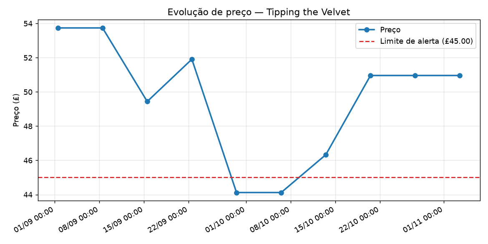
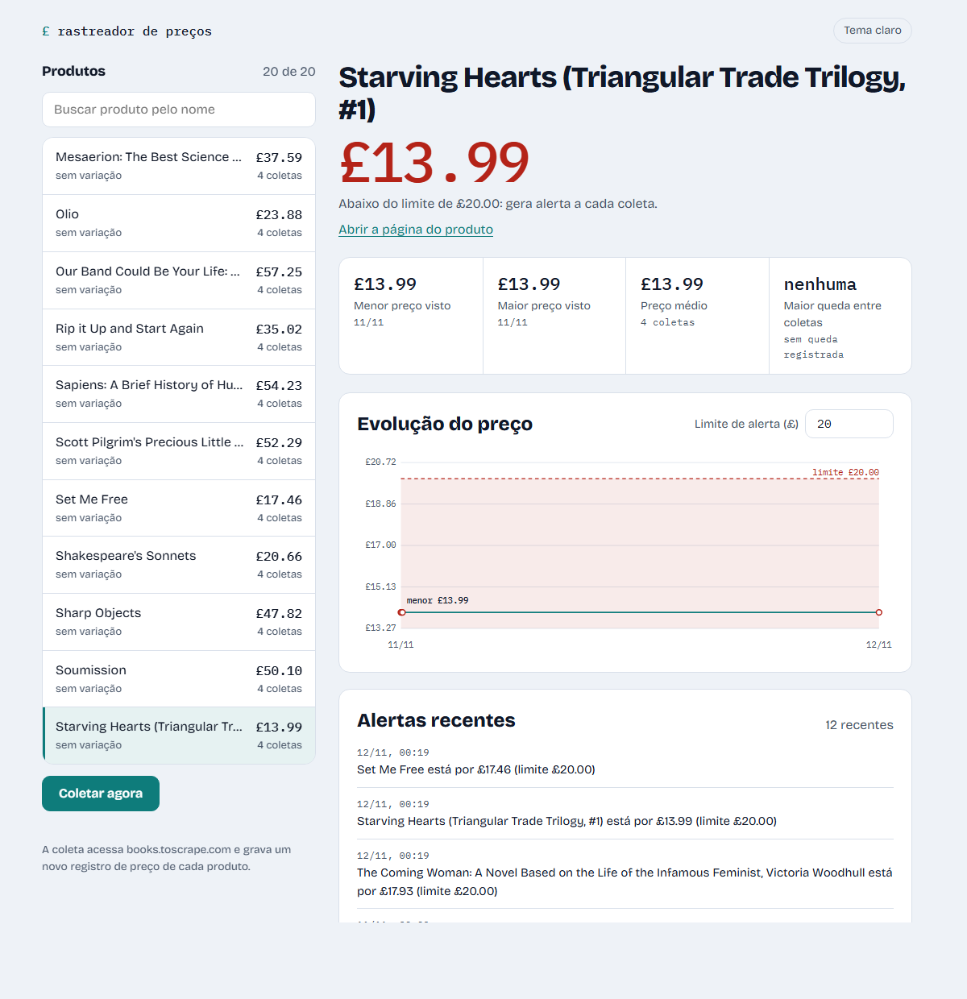
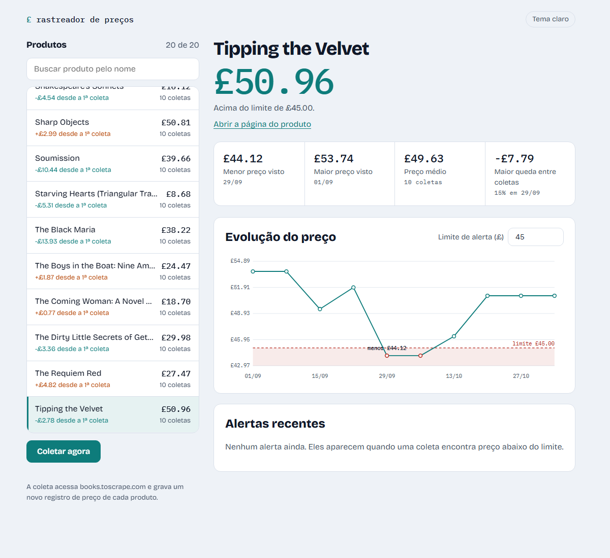
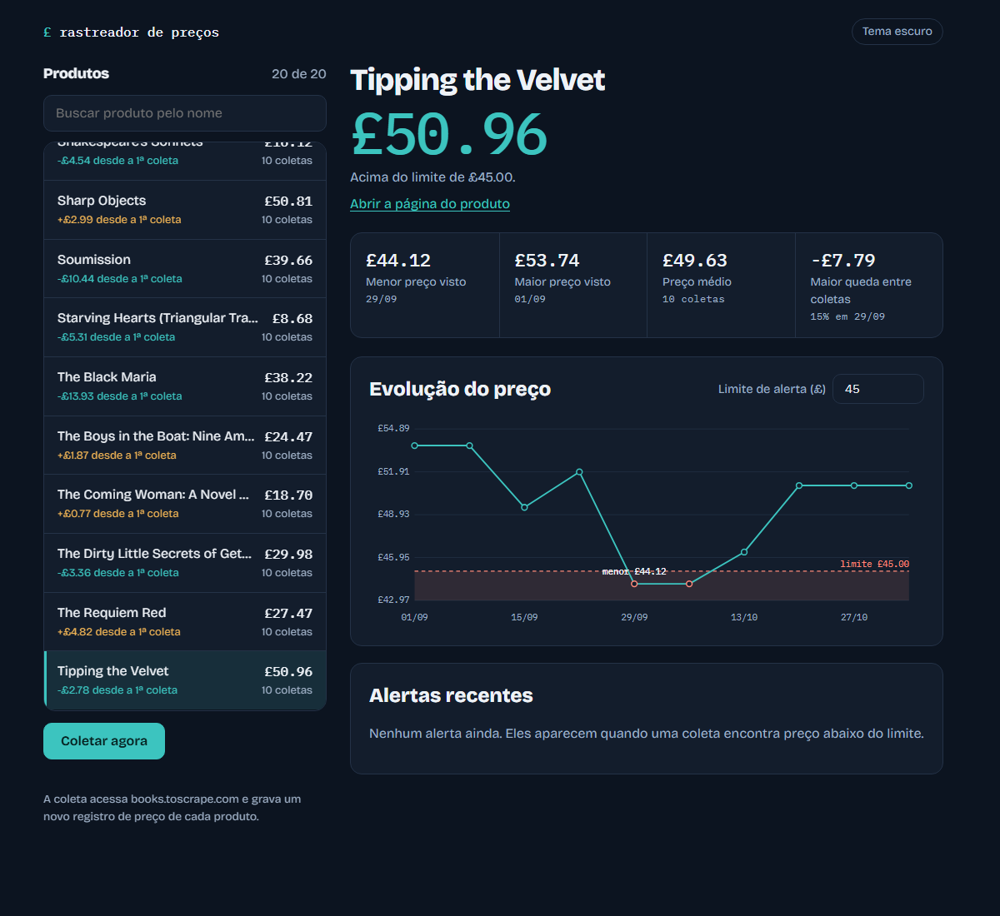

# Rastreador de Preços

<p align="left">
  
  
  
  
  
</p>

Robô de automação em Python que **monitora o preço de produtos ao longo do tempo**, guarda o histórico em SQL (SQLite) e **gera um alerta quando o preço cai abaixo de um limite** definido. Também analisa o histórico e desenha o gráfico de evolução de preço de um produto.

Os dados vêm do [books.toscrape.com](https://books.toscrape.com), um site público feito para praticar scraping.

## Funcionalidades

- **Scraper** (requests + BeautifulSoup4): coleta nome, preço e disponibilidade; segue a paginação do catálogo (20 produtos por página).
- **Histórico em SQLite**: cada execução grava um *snapshot* de preço com data/hora de cada produto.
- **Modo automático**: coleta periódica com a biblioteca `schedule`, com log de cada execução (também dá para agendar via cron — veja abaixo).
- **Alertas**: quando o preço fica abaixo do limite (global ou por produto), grava em `alertas.log` e no log da execução.
- **Análise**: resumo (menor/maior preço, preço médio, maior queda entre coletas) e gráfico com matplotlib.
- **Painel web** (`servir`): lista de produtos com busca, gráfico de preço com o limite de alerta, resumo, alertas recentes e botão para coletar na hora, tudo no navegador.
- **Robustez**: falha de rede não derruba o agendador — o erro é logado e a próxima execução tenta de novo.

## Estrutura

```
rastreador-precos/
├── src/
│   ├── scraper.py     # Download e parsing do HTML (requests + BeautifulSoup4)
│   ├── banco.py       # SQLite: tabelas, snapshots, consultas de histórico
│   ├── alertas.py     # Regra de alerta por limite + registro em arquivo
│   ├── coleta.py      # Orquestra: coletar -> salvar -> alertar (+ logs)
│   ├── agendador.py   # Coleta periódica (schedule)
│   ├── analise.py     # Resumo estatístico e gráfico (matplotlib)
│   ├── web.py         # Painel web local (http.server) com API JSON
│   ├── static/        # Páginas do painel: index.html, style.css, app.js
│   ├── demo.py        # Histórico SIMULADO, só para demonstrar a análise
│   └── cli.py         # Interface de linha de comando
├── tests/             # 49 testes pytest (sem internet: HTTP mockado com `responses`)
│   └── fixtures/      # HTML real do catálogo, salvo localmente
├── imgs/
└── requirements.txt
```

## Como executar

```bash
cd rastreador-precos
pip install -r requirements.txt

python src/cli.py coletar --limite 20          # uma coleta agora (alerta se preço < £20)
python src/cli.py agendar --intervalo-min 60   # coleta a cada 60 min (Ctrl+C para parar)
python src/cli.py listar                       # produtos com o último preço
python src/cli.py analisar "starving hearts"   # resumo + gráfico em imgs/
python src/cli.py servir --limite 20           # painel web em http://127.0.0.1:8000
```

Opções úteis: `--paginas N` (padrão 1 = 20 produtos), `--limites-json arquivo.json` (limites individuais, formato `{"id_do_produto": 15.0}`), `--db`, `--log`, `--alertas`. Use `python src/cli.py <comando> --help` para ver todas.

### Exemplo real de uso

Saída real de `python src/cli.py coletar --limite 20` (a coleta acessa o site de verdade):

```text
2026-11-11 23:33:46,767 | INFO | Iniciando coleta (1 página(s))
2026-11-11 23:33:48,334 | WARNING | ALERTA: The Coming Woman: A Novel Based on the Life of the Infamous Feminist, Victoria Woodhull está por £17.93 (limite £20.00)
2026-11-11 23:33:48,335 | WARNING | ALERTA: Starving Hearts (Triangular Trade Trilogy, #1) está por £13.99 (limite £20.00)
2026-11-11 23:33:48,336 | WARNING | ALERTA: Set Me Free está por £17.46 (limite £20.00)
2026-11-11 23:33:48,336 | INFO | Coleta concluída: 20 produtos salvos, 3 alerta(s)
```

Modo automático (`agendar --intervalo-min 0.1 --execucoes 2 --limite 20`, uma coleta imediata e outra 6 segundos depois — as linhas de alerta foram omitidas aqui):

```text
2026-11-11 23:33:49,972 | INFO | Agendador iniciado: coleta a cada 6 segundo(s). Ctrl+C para parar.
2026-11-11 23:33:49,973 | INFO | Iniciando coleta (1 página(s))
2026-11-11 23:33:51,141 | INFO | Coleta concluída: 20 produtos salvos, 3 alerta(s)
2026-11-11 23:33:55,972 | INFO | Iniciando coleta (1 página(s))
2026-11-11 23:33:57,062 | INFO | Coleta concluída: 20 produtos salvos, 3 alerta(s)
```

`python src/cli.py listar --limite 5`:

```text
£ 51.77  A Light in the Attic                           em estoque  [a-light-in-the-attic_1000]
£ 45.17  It's Only the Himalayas                        em estoque  [its-only-the-himalayas_981]
£ 51.33  Libertarianism for Beginners                   em estoque  [libertarianism-for-beginners_982]
£ 37.59  Mesaerion: The Best Science Fiction Stories 1  em estoque  [mesaerion-the-best-science-fiction-stories-1800-1849_983]
£ 23.88  Olio                                           em estoque  [olio_984]
```

Conteúdo real do `alertas.log` (uma linha por alerta, com data/hora, id do produto e mensagem):

```text
2026-11-11T23:33:48 | ALERTA | starving-hearts-triangular-trade-trilogy-1_990 | Starving Hearts (Triangular Trade Trilogy, #1) está por £13.99 (limite £20.00)
```

> Um alerta é emitido **a cada coleta** em que o preço continua abaixo do limite (por isso as 3 execuções acima geraram 9 linhas no arquivo). Não há deduplicação por enquanto.

### Análise do histórico

Como o books.toscrape.com é um site **estático** (os preços nunca mudam), o histórico real fica "reto". Saída real do `analisar` após 3 coletas reais:

```text
Produto: Starving Hearts (Triangular Trade Trilogy, #1)
Coletas: 3 (2026-11-11T23:33:48 → 2026-11-11T23:33:57)
Preço atual: £13.99 (inicial £13.99, variação +0.00)
Menor preço visto: £13.99 em 2026-11-11T23:33:48
Maior preço visto: £13.99 em 2026-11-11T23:33:48
Preço médio: £13.99
Maior queda: nenhuma queda registrada
```

Para mostrar a análise com preços variando, o comando `demo` cria um banco **separado e SIMULADO** (`demo.db`): parte dos preços reais coletados e aplica variações pseudoaleatórias (semente fixa) em 10 snapshots semanais. **Estes números são simulados** e servem só para demonstrar o resumo e o gráfico:

```bash
python src/cli.py demo
python src/cli.py analisar "tipping the velvet" --db demo.db --limite 45 --grafico imgs/exemplo_simulado.png
```

```text
Produto: Tipping the Velvet
Coletas: 10 (2026-09-01T12:00:00 → 2026-11-03T12:00:00)
Preço atual: £50.96 (inicial £53.74, variação -2.78)
Menor preço visto: £44.12 em 2026-09-29T12:00:00
Maior preço visto: £53.74 em 2026-09-01T12:00:00
Preço médio: £49.63
Maior queda: -£7.79 (15.0%) — de £51.91 para £44.12 em 2026-09-29T12:00:00
Gráfico salvo em: imgs/exemplo_simulado.png
```



*(Dados simulados — a linha vermelha tracejada é o limite de alerta.)*

## Painel web

`python src/cli.py servir --limite 20` abre um painel em `http://127.0.0.1:8000`, sem instalar nada além do `requirements.txt` (o servidor usa só a biblioteca padrão do Python). Dá para buscar um produto, ver o histórico de preço com a linha do limite de alerta (a zona abaixo dela fica sombreada), conferir o resumo, ler os alertas recentes e clicar em **Coletar agora** para buscar os preços de verdade. O botão de tema alterna entre automático, claro e escuro, e `?produto=<id>` abre direto em um produto.

Painel com dados **reais** (coletas feitas no books.toscrape.com, limite de £20): o preço está abaixo do limite, por isso aparece em vermelho. A linha é reta porque o site é estático.



Painel com histórico **simulado** (banco `demo.db`, criado por `python src/cli.py demo` e aberto com `servir --db demo.db`), para mostrar como fica quando o preço varia. Estes valores não são reais:





> O GitHub só mostra o código e as imagens: o painel precisa ser executado na sua máquina. Ele escuta só em `127.0.0.1` por padrão (use `--host` para mudar, sabendo que não há autenticação).

## Agendando com cron (Linux/macOS)

Em vez de deixar o `agendar` rodando, dá para chamar `coletar` periodicamente pelo cron. Edite com `crontab -e`:

```cron
# coleta a cada hora, no minuto 0
0 * * * * cd /caminho/para/rastreador-precos && /usr/bin/python3 src/cli.py coletar --limite 20 >> cron.log 2>&1
```

No Windows, o equivalente é o **Agendador de Tarefas** executando `python src/cli.py coletar --limite 20`.

## Modelo de dados (SQLite)

```sql
produtos(id TEXT PK, nome TEXT, url TEXT)

historico_precos(
    id INTEGER PK AUTOINCREMENT,
    produto_id TEXT -> produtos.id,
    preco REAL,
    disponivel INTEGER,      -- 1 = em estoque
    coletado_em TEXT         -- ISO 8601, ex.: 2026-11-11T23:33:48
)
```

Consulta de exemplo — os 3 produtos mais baratos da última coleta:

```sql
SELECT p.nome, h.preco
FROM historico_precos h JOIN produtos p ON p.id = h.produto_id
WHERE h.coletado_em = (SELECT MAX(coletado_em) FROM historico_precos)
ORDER BY h.preco LIMIT 3;
```

## Testes

```bash
pytest
```

49 testes que **não dependem de internet**: as requisições HTTP são mockadas com a biblioteca `responses`, usando páginas reais do catálogo salvas em `tests/fixtures/`. Cobrem parsing (preço, estoque, paginação), banco, regras de alerta, análise/gráfico, agendador e o fluxo completo da CLI.

## Tecnologias

Python · requests · BeautifulSoup4 · SQLite · schedule · matplotlib · pytest · responses

## Aviso

Projeto de estudo. O site alvo (books.toscrape.com) existe justamente para prática de scraping; o scraper usa um User-Agent identificado e faz poucas requisições.
